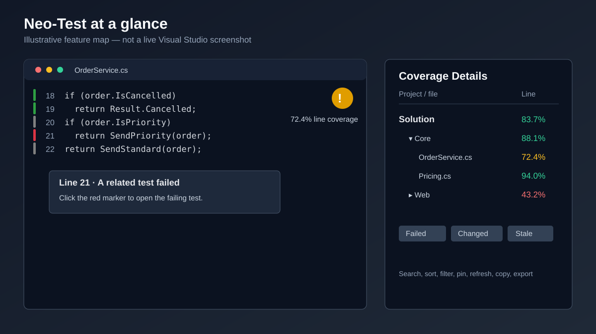

# Neo-Test

Neo-Test is a Visual Studio VSIX extension that brings test results and code coverage into the editor. It watches a solution-relative results directory, reads coverage reports as they arrive, and marks the corresponding source lines.

The extension targets the Visual Studio 17.x extensibility API (Visual Studio 2022 and later) and is built on .NET Framework 4.7.2.

## Why Neo-Test?

Coverage is most useful at the point where you edit code. Neo-Test keeps the latest test coverage, failed-test locations, and file-level summary in Visual Studio so you can see what to test next without switching to a separate report viewer.

## Visual tour



The diagram is an illustration of the implemented UI, not a captured Visual Studio screenshot. It shows the editor rail, the file badge, and the Coverage Details view. Replace it with real in-IDE screenshots or a short GIF before a public release.

## Compatibility and prerequisites

| Requirement | Details |
| --- | --- |
| Host | Visual Studio compatible with the 17.x extensibility API on Windows. |
| To build from source | Visual Studio with the **Visual Studio extension development** workload and the .NET Framework 4.7.2 targeting pack. |
| To consume reports | Cobertura or OpenCover XML; TRX is optional and supplies failed-test locations. |
| Changed-line coverage | Git is required only when using the Changed filter or diff-base setting. |

## What it does

- Shows a narrow editor-margin marker for each reportable line:
  - **Green** — covered.
  - **Gray** — reportable but not covered.
  - **Red** — appears in a failed test's TRX stack trace; this takes precedence over coverage.
- Provides line tooltips with hit and branch counts. Clicking a red marker opens the related failed test location.
- Adds a per-file coverage badge to the top-right of a covered editor: green, amber, or red based on configurable line-coverage thresholds.
- Detects source files changed after the report was generated and fades their markers/badges so stale results are clear.
- Displays solution, project, and file line/branch coverage in a Coverage Details tool window. It supports search, sorting, failure/low-coverage/stale/changed/pinned filters, test-project exclusion, session-only pins, refresh, copy-summary, and double-click-to-open.
- Supports solution and per-project coverage targets, changed-line coverage based on `git diff`, CSV/Markdown/HTML export, and notifications when a file's badge category drops.
- Can optionally run a configured coverage command or a current-file test command from Visual Studio.

## Supported input

Neo-Test scans the configured results directory and all of its subdirectories for:

| Purpose | File name pattern |
| --- | --- |
| Coverage | `*.cobertura.xml` (for example, Coverlet Cobertura output) |
| Coverage | `*.opencover.xml` |
| Failed-test locations | `*.trx` |

Coverage reports are merged. File-system events are debounced so parallel test runs do not temporarily show partial results. A cached copy of unchanged reports avoids rereading every report on each update.

By default the results directory is `TestResults` below the solution directory. It must be a relative, non-traversing path; change it in Neo-Test Settings if your test runner writes elsewhere. During a brief report cleanup/replacement window, the last valid result is retained for 30 seconds by default.

## Install from source

1. Install Visual Studio with the **Visual Studio extension development** workload.
2. Open [NeoTest.slnx](NeoTest.slnx).
3. Restore and build the `NeoTest` project.
4. Install the generated VSIX, normally at `src/bin/<Configuration>/net472/Neo-Test.vsix`.
5. Restart Visual Studio if prompted, then open a solution to begin watching its results directory.

Package versions are centrally managed in [Directory.Packages.props](Directory.Packages.props).

## Quick start

Run tests from the solution directory and ensure the resulting report files end up below the solution's `TestResults` directory. This Coverlet example emits a Cobertura report; add a TRX logger to show failed-test locations:

```powershell
dotnet test .\tests\MyProject.Tests\MyProject.Tests.csproj `
  --results-directory .\TestResults `
  --logger "trx;LogFileName=tests.trx" `
  /p:CollectCoverage=true `
  /p:CoverletOutputFormat=cobertura `
  /p:CoverletOutput=TestResults/coverage
```

Replace the test-project path for your solution. If the runner writes files elsewhere, either adjust its output path or set **Results directory** in Neo-Test Settings.

As reports are written, open editors refresh automatically. The **Tools** menu provides commands to open Coverage Details, refresh or clear results, export a report, navigate to the next uncovered or failed-test line, and run/cancel configured test commands.

Default keyboard shortcuts:

| Command | Shortcut |
| --- | --- |
| Next Uncovered Line | `Ctrl+Alt+U` |
| Next Failed-Test Line | `Ctrl+Alt+F` |

You can rebind these in Visual Studio's Keyboard options.

## Troubleshooting

| Symptom | Check |
| --- | --- |
| No editor markers | Verify the report exists under the configured relative results directory and has a supported filename suffix. Use **Refresh Neo-Test Coverage** after producing it. |
| Coverage Details says no report was found | Confirm the command is being run for the open solution and that `TestResults` is not being written beneath an individual test-project directory instead. |
| Coverage loads but no source file is marked | The paths in the report must resolve to local files. Add a `reportPrefix=>localPrefix` mapping for container, WSL, or remote-agent paths. |
| Failure markers are missing | Emit TRX output and make sure its stack traces include local file paths and line numbers. |
| Results disappear during a test run | Neo-Test retains missing results for 30 seconds by default. Increase **Retain missing results** if your runner replaces reports more slowly. |
| Changed filter is unavailable | Open a solution inside a Git repository, make sure Git is available on `PATH`, and use an existing diff-base reference. |

## Settings

Open **Tools → Open Neo-Test Settings** for a themed settings window, or use **Tools → Options → Neo-Test → General**. Both write to the same Visual Studio profile settings.

| Area | Key settings |
| --- | --- |
| Appearance | Covered, uncovered, and failed-test colors; good and warning badge thresholds. |
| Reports | Results directory, parallel-result grouping window, retention interval, path mappings, and Git diff base reference. |
| Test execution | A solution-level command, a current-file command, and timeout. Current-file commands may contain `{file}` (quoted full path) and `{name}` (file name). |
| Coverage | Minimum solution line/branch coverage and project rules such as `Core.*=>80,70`. |
| Filtering | Explicit project include/exclude patterns and generated-file patterns. Generated files are excluded by default. |

Path mappings use semicolon-separated `reportPrefix=>localPrefix` entries, which is useful when reports were generated in a container, WSL, or remote build environment. The longest matching report prefix is applied.

Set **Diff base reference** (default `HEAD`) to identify changed source lines with `git diff`. The **Changed** filter in Coverage Details then shows files containing changed lines; a changed but uncovered line receives a red leading edge in the editor marker. If the solution is not in a Git repository or the base reference cannot be found, the tool window reports that diff coverage is unavailable.

Quality gates are informational: their pass/fail status is displayed in Neo-Test; they do not change the test process exit code.

## Current limitations

- Only Cobertura, OpenCover, and TRX inputs are read; report filenames must use the supported suffixes.
- Quality gates are displayed in the extension and do not fail a CI build or alter a test command's exit code.
- Pins are scoped to the current Visual Studio session.
- The visual tour above is illustrative; no captured product screenshots or Marketplace release artifact are included in this repository.

## Implementation notes

- `CodeCoveragePackage` owns package registration, menu commands, settings, the report watcher, and optional test-process lifecycle.
- `CoverageReportWatcher` recursively observes report files and merges Cobertura, OpenCover, and the newest batch of TRX results.
- `CoverageMargin` and `CoverageSummaryBadgeMargin` render the editor indicators.
- `CoverageDetailsToolWindow` and `CoverageSettingsToolWindow` contain the WPF interfaces.
- `CoberturaReader`, `OpenCoverReader`, and `TrxReader` parse the supported formats; `CoveragePathMapper` reconciles report paths with local files.

## Known follow-up work

See [BACKLOG.md](BACKLOG.md) for planned Solution Explorer indicators and retained coverage-history/delta reporting.

## Project status, contributing, and licensing

This repository currently provides a source build; it does not include a Visual Studio Marketplace link or a packaged release workflow. Build and install the VSIX using the instructions above.

Contributions are welcome. See [CONTRIBUTING.md](CONTRIBUTING.md) for the local build and validation workflow.

No license file is currently included. Add an explicit `LICENSE` before redistributing the extension or accepting third-party contributions under defined terms.
