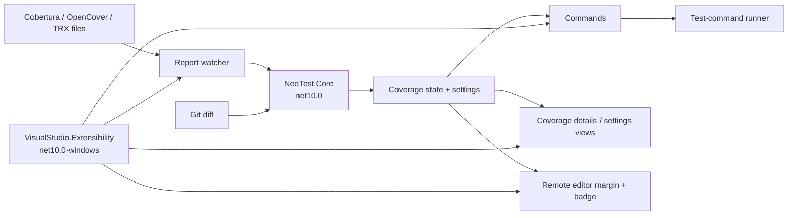

# Design: .NET 10 upgrade for Neo-Test

**Status:** Proposed - subject to feasibility spike  
**Date:** 2026-10-16  
**Decision scope:** the Visual Studio extension implementation, packaging, build, and supported host versions.

## Context

Neo-Test is currently one SDK-style project (`src/NeoTest.csproj`) that builds a legacy, in-process VSPackage. It targets `net481`, uses WPF, and packages a VSIX through `Microsoft.VSSDK.BuildTools`.

The package owns commands, options, tool windows, report watching, and test execution. Its editor affordances are MEF/WPF margins. The implementation directly depends on `Microsoft.VisualStudio.Shell`, `Microsoft.VisualStudio.Text.*`, `EnvDTE`, and `IVsWindowFrame`.

The repository already has a valid Visual Studio 17+ manifest lower bound (`[17.0,)`) and 64-bit product architecture. That is sufficient for the existing VSIX compatibility model; changing the .NET target is a separate concern.

### Constraints discovered

| Area | Current state | Upgrade implication |
| --- | --- | --- |
| Target | `net481` | The .NET 10 target must be Windows-specific: `net10.0-windows`. |
| Host integration | In-process `AsyncPackage`, `DialogPage`, `OleMenuCommandService`, `EnvDTE` | These APIs cannot be carried into a .NET 10 process unchanged. |
| Editor UI | WPF `IWpfTextViewMarginProvider` and WPF controls | A modern out-of-process extension uses remote UI controls instead of directly hosting WPF. |
| VS SDK | `Microsoft.VisualStudio.SDK` 17.0.32112.339 | The SDK meta-package has .NET Framework assets, so it does not make the current VSPackage buildable as .NET 10. |
| Packaging | Explicit `obj/<configuration>/<TFM>` VSIX paths and imported VSSDK targets | Packaging must be replaced by the modern extension project/package flow; paths must not be hand-derived from `$(TargetFramework)`. |
| Automated coverage | None | Behavioural regression protection must be added before or alongside the migration. |

## Goals

- Deliver a .NET 10 (`net10.0-windows`) Neo-Test implementation for the modern Visual Studio extension model.
- Preserve user-visible features: report ingestion, coverage/failure navigation, file summaries, filters, exports, quality gates, test commands, and configurable settings.
- Preserve the narrow editor coverage indicator and file badge, adapted to the supported remote editor UI model.
- Make parsing, merging, filtering, quality-gate, path-mapping, and diff-coverage logic independently testable.
- Produce reproducible VSIX artifacts without depending on a .NET Framework targeting pack.
- Establish an explicit, tested support matrix rather than infer host compatibility from a VSIX manifest range.

## Non-goals

- Retargeting the legacy `AsyncPackage` project in place.
- Redesigning coverage rules or report formats.
- Requiring a Marketplace release as part of this upgrade.
- Guaranteeing one binary works in both the legacy in-process VS 2022 API model and the .NET 10 model.

## Decision

Adopt `VisualStudio.Extensibility` for a new host-facing extension on `net10.0-windows`, and extract host-independent behavior into a .NET 10 core library. Do not attempt to change the legacy VSPackage's `TargetFramework` directly.

This is a conditional architecture decision. It becomes final only when the Phase 0 spike proves that the chosen, non-preview package versions can package and run the required command, tool-window, editor-margin, settings, and document/solution scenarios on every supported Visual Studio version. Until then, no product support range or legacy retirement date is committed.

Use a staged, parallel migration:

1. Extract the report/domain core and cover it with tests while preserving existing behaviour.
2. Build a modern .NET 10 host adapter and reproduce the extension's supported experience against an experimental instance.
3. Ship the .NET 10 VSIX only for the Visual Studio versions validated by the spike. Keep the existing `net481` artifact as a separately maintained compatibility release only if Visual Studio 2022 support remains a product requirement.

The old and new hosts must be separate projects/artifacts. Multi-targeting the current project (`net481;net10.0-windows`) is explicitly rejected: NuGet and compile-time API references differ, and an in-process VSPackage cannot load a .NET 10 assembly as a substitute for the .NET Framework assembly.

## Target architecture

### Project boundaries

| Project | TFM | Responsibility | May reference Visual Studio APIs? |
| --- | --- | --- | --- |
| `src/NeoTest.Core` | `net10.0` | Coverage models, Cobertura/OpenCover/TRX readers, merge/cache policy, filters, path mapping, diff parsing, quality gates, CSV/Markdown/HTML generation. | No |
| `src/NeoTest.Core.Tests` | `net10.0` | Unit and fixture tests for every core behaviour. | No |
| `src/NeoTest.Extension` | `net10.0-windows` | `VisualStudio.Extensibility` entry point, commands, editor contributions, remote controls, host lifecycle, service adapters, VSIX packaging. | Yes |
| `src/NeoTest.Legacy` (optional transition artifact) | `net481` | The unchanged current VSPackage, serviced only for VS 2022 users during the agreed support window. | Yes |

`NeoTest.Core` owns immutable report snapshots. It exposes an interface-based snapshot service rather than static global state. The extension project supplies the file-system watcher, solution/workspace context, UI dispatching, process execution, and persistence adapters. This prevents host API types from leaking into parsing or policy code.

`CoverageSession` is the single writer of session state. Every refresh produces a monotonically increasing snapshot version; consumers render only the newest version. Refresh, disposal, and process cancellation are governed by one extension-lifetime cancellation token. This is the concurrency contract for report changes, solution close, and Visual Studio shutdown.

## Host migration map

| Existing area | Modern replacement | Design notes |
| --- | --- | --- |
| `CodeCoveragePackage : AsyncPackage` | Extension entry point plus dependency-injected services | Initialize asynchronously; cancel all watcher/process work at disposal. |
| VSCT/menu commands | `VisualStudio.Extensibility` command contributions | Preserve command names/shortcuts where the contribution model permits; verify menu placement manually. |
| `CoverageMargin` and `CoverageSummaryBadgeMargin` | Text-view margin providers and `RemoteUserControl` templates | Do not reuse WPF `UIElement` code. Create render models from coverage snapshots and keep remote UI minimal. |
| WPF tool windows | Modern tool-window/remote UI contributions | Recreate Coverage Details first; settings can use a dedicated view. |
| `DialogPage`/VS profile values | Stable modern settings API when available; otherwise a versioned JSON store owned by Neo-Test | Do not depend on an API marked preview in a release build. Provide an explicit, idempotent import only when a supported read path is proven. |
| `EnvDTE` solution/document access | Modern workspace/document APIs | Avoid COM automation in new code. |
| `Process`/`cmd.exe` runner | Injectable process runner using `ProcessStartInfo.ArgumentList` where commands can be structured | The existing free-form command remains an intentional shell invocation; document it as trusted local configuration. |
| `CoverageStore` static singleton | Scoped `CoverageSession` service | Publish snapshots atomically, marshal only UI updates to the UI boundary, and avoid blocking joins. |

## Data and behaviour preservation

The core migration is behavior-preserving. Create XML fixtures for the supported report shapes before moving each reader. Test these contracts:

- Cobertura and OpenCover line hits, branches, and multi-report merging.
- TRX failure-location selection and parallel-batch windowing.
- report-to-local path mappings, generated-file exclusions, and include/exclude patterns.
- stale-report retention, unreadable/partially written report handling, and watcher refresh debouncing.
- Git unified-diff hunk parsing, including added/deleted files and spaces in paths.
- solution/project quality thresholds and CSV, Markdown, and HTML exports.

Preserve the current results-directory validation: it is solution-relative and rejects rooted and traversing paths. Keep report parsing defensive (bounded input, cancellation checks, malformed-file handling) because reports are external input.

All XML readers must use explicit secure reader settings: prohibit DTD processing and external entity resolution, apply a bounded document/input size, and surface malformed or oversized reports as a recoverable status. The watcher must treat the results directory as untrusted input and must not follow report paths outside the configured root.

## Settings migration

Settings currently live in the Visual Studio profile through `CoverageOptionsPage`. The new settings schema must retain the current keys and defaults: colors, thresholds, result directory, report mappings, filtering, diff base, test commands/timeouts, retention, notifications, and project thresholds.

On first .NET 10 activation, the extension should offer to import legacy values only if a supported, reliable read path is demonstrated in the spike. Store a schema version and a completion marker so import is repeatable but never overwrites values already edited in the modern extension. If no supported read path exists, start with defaults and provide a concise migration guide instead of reading Visual Studio profile storage directly. Validation stays in the core/settings layer, not in a view. Export/import of the new settings JSON is out of scope unless independently requested.

The new store must be per-user, use an application-owned location, write atomically, and reject invalid values before persistence. Settings that invoke test commands are a local trust boundary: Neo-Test must never accept them from coverage reports, solution files, or source-controlled configuration without an explicit future design decision.

## Build, packaging, and compatibility

- Pin the .NET 10 SDK with `global.json` after choosing the supported feature band; use the same SDK in CI.
- Update centrally managed package versions only after a clean restore resolves the target framework. The current `Microsoft.VisualStudio.SDK` package is a legacy VSPackage dependency; use the `VisualStudio.Extensibility` package/tooling selected by the spike for the new host instead of assuming the old package applies.
- Prefer the project layout and packaging targets generated by the current `VisualStudio.Extensibility` template. Remove the manual VSSDK import and all manually constructed `obj/.../net481` manifest/cache properties once the modern package build owns them.
- Retain the existing VSIX identity and `InstallationTarget` semantics only after confirming the new packaging model's manifest requirements. Avoid two simultaneously installable artifacts with the same identity and overlapping host range.
- Publish an explicit support matrix of Visual Studio version, extension package version, .NET SDK, architecture, and installation result. Do not claim Visual Studio 2022 support, or exclude it, until this matrix is demonstrated. VSIX manifest compatibility alone is not runtime compatibility.

## Delivery plan

### Phase 0 - baseline and decision gate

1. Record baseline manual scenarios in an experimental instance.
2. Add report fixtures and core regression tests around current behaviour.
3. Create a template-based .NET 10 extension spike that proves package build, install, command contribution, a tool window, a remote text-view margin, settings persistence, and document/solution access.
4. Run the spike against every candidate Visual Studio host and record its support matrix.
5. Decide whether VS 2022 support requires the optional legacy artifact and set its retirement criteria.

**Exit criteria:** the spike builds with the pinned SDK, installs into an experimental instance, and demonstrates the required contributions without preview APIs, composition/load errors, or UI-thread blocking. The supported host matrix and legacy-support decision are recorded.

### Phase 1 - core extraction

Move pure code from readers, coverage models/store calculations, filters, path mapper, diff parsing, quality gates, and export formatting into `NeoTest.Core`. Replace static mutable state with a `CoverageSession` interface and immutable snapshots.

**Exit criteria:** fixture tests pass and the legacy adapter, if retained during transition, produces equivalent summaries for the fixture corpus.

### Phase 2 - modern host

Implement solution lifecycle, watcher, settings, commands, details view, settings view, editor margin/badge, navigation, and test runner as .NET 10 adapters. Reuse only core contracts, never legacy VSPackage classes.

**Exit criteria:** all features in the README's "What it does" and "Settings" sections have an acceptance scenario or an explicitly approved deferral.

### Phase 3 - package and release readiness

Validate upgrade/install/uninstall, fresh install, settings migration, malformed reports, large/parallel report sets, cancellation/timeout, light/dark themes, and Visual Studio restart. Update README and CONTRIBUTING build paths and prerequisites.

**Exit criteria:** release build creates one verified .NET 10 VSIX, automated core tests pass, and the manual matrix below is signed off.

## Validation matrix

| Test | Expected result |
| --- | --- |
| Build from clean checkout | Restore, tests, analyzers, and VSIX package succeed with pinned .NET 10 SDK. |
| Experimental instance | Package autoloads after solution open; no composition/load errors. |
| Report lifecycle | Create/change/replace/delete reports; debounce and retention match fixture contracts. |
| Editor | Margin, badge, tooltips, navigation, stale/changed/failure states render correctly in light and dark themes. |
| Tool windows and settings | Details filtering/sorting/export work; validated settings survive restart and legacy import does not overwrite modern edits. |
| Commands | Refresh, clear, navigation, run/cancel, settings, and exports have correct enablement and status. |
| Compatibility | Install only on declared supported Visual Studio version(s); legacy and modern artifacts do not conflict. |
| Security and resilience | DTD/external-entity, oversized, malformed, locked, and replaced report fixtures fail safely; all background work stops on solution close and extension disposal. |
| Performance | A representative multi-report corpus refreshes without UI-thread blocking; measure and record baseline, median, and worst-case refresh time. |

## Risks and mitigations

| Risk | Mitigation |
| --- | --- |
| The modern API lacks a needed parity point or marks it preview. | Prove each contribution in Phase 0; retain the legacy artifact or defer only the affected feature by an explicit decision. |
| Remote UI differs from the WPF implementation. | Define view models and visual acceptance screenshots; do not port WPF controls directly. |
| Settings/profile migration loses preferences. | Schema-versioned, opt-in/idempotent import plus before/after test data. |
| Concurrent watcher/process work updates stale UI. | Snapshot versioning, cancellation, and host-lifetime ownership; UI subscribes to latest snapshot only. |
| Duplicate VSIX identity causes update/install ambiguity. | Choose non-overlapping host ranges or distinct transition identities before publishing. |
| Missing automated tests allows parser regressions. | Make fixture tests a Phase 0/1 release gate. |
| A .NET 10 package is technically compatible but lacks a stable host feature needed for parity. | Treat feature parity as a release gate; retain legacy delivery or obtain an explicit product deferral. |
| User-configured test commands are executed in an unintended context. | Keep commands local-only, show the working directory in status/UI, and terminate the process tree on cancel/timeout. |

## Alternatives considered

### Change `net481` to `net10.0-windows`

Rejected. The project depends on .NET Framework VS SDK assets and in-process APIs; it will not become a viable .NET 10 extension by changing one property.

### Keep the legacy project and only update package versions

Rejected as the .NET 10 upgrade path. It can improve maintenance and preserve VSIX compatibility, but it leaves the extension on .NET Framework.

### Rewrite only the UI while retaining legacy host code

Rejected. The host/UI boundary is where the incompatible APIs are concentrated. A mixed model would preserve COM/WPF/legacy coupling and create the most difficult lifecycle surface.

### Use a single multi-targeted project

Rejected. It conceals mutually exclusive host dependencies and does not solve runtime loading. Separate adapter projects make compatibility and packaging explicit.

### Commit to a Visual Studio support range before the spike

Rejected. The VSIX manifest's API compatibility range does not prove that a .NET 10 out-of-process extension, its contribution points, and its packaging toolchain work in a given host. The support matrix is an output of Phase 0.

## External references

- [Visual Studio extension compatibility model](https://learn.microsoft.com/en-us/visualstudio/extensibility/migration/extension-compatibility?view=visualstudio) - Visual Studio 2026 uses API-version compatibility for VSIX and existing 17.x extensions remain compatible when they use supported APIs.
- [Target frameworks in SDK-style projects](https://learn.microsoft.com/en-us/dotnet/standard/frameworks) - .NET 10 TFMs and Windows-specific target framework behavior.
- [Visual Studio SDK NuGet package](https://www.nuget.org/packages/Microsoft.VisualStudio.SDK/) - current SDK meta-package framework asset information.
- [Extend the Visual Studio editor with a new margin](https://learn.microsoft.com/en-us/visualstudio/extensibility/visualstudio.extensibility/editor/walkthroughs/textview-margin?view=visualstudio) - remote controls are required because modern extensions can run out of process.
- [Visual Studio Extensibility settings](https://learn.microsoft.com/en-us/visualstudio/extensibility/visualstudio.extensibility/settings/settings?view=vs-2022) - settings API status and model.
